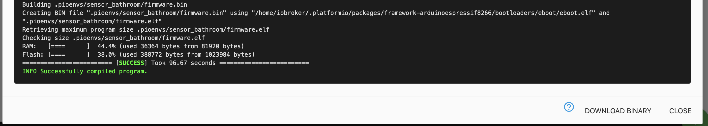
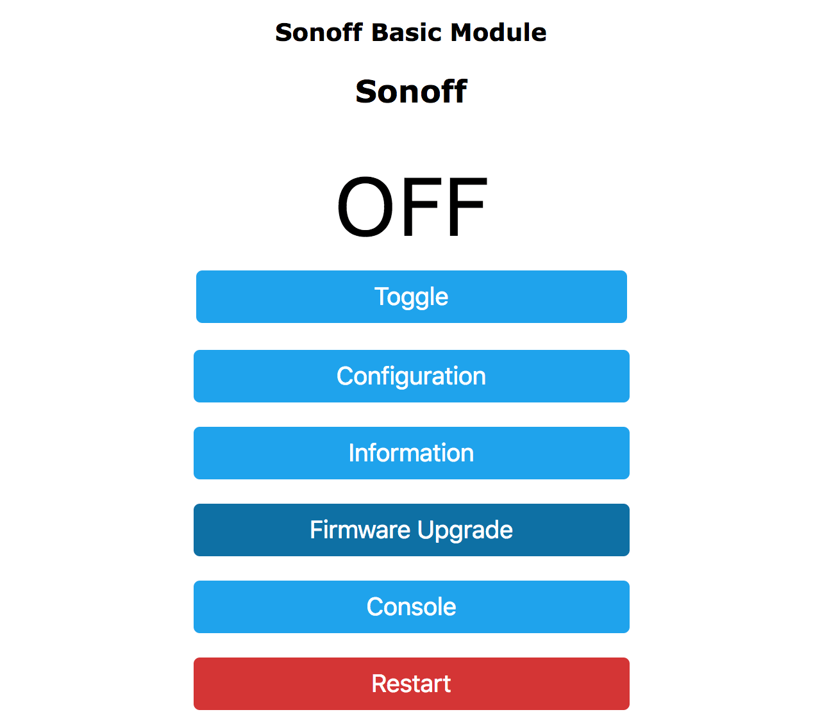
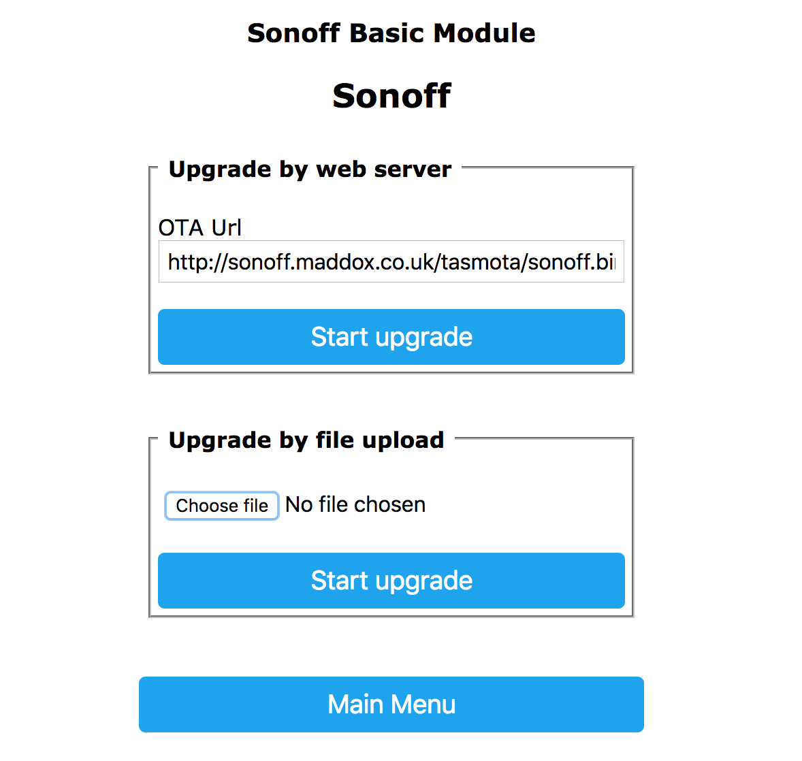
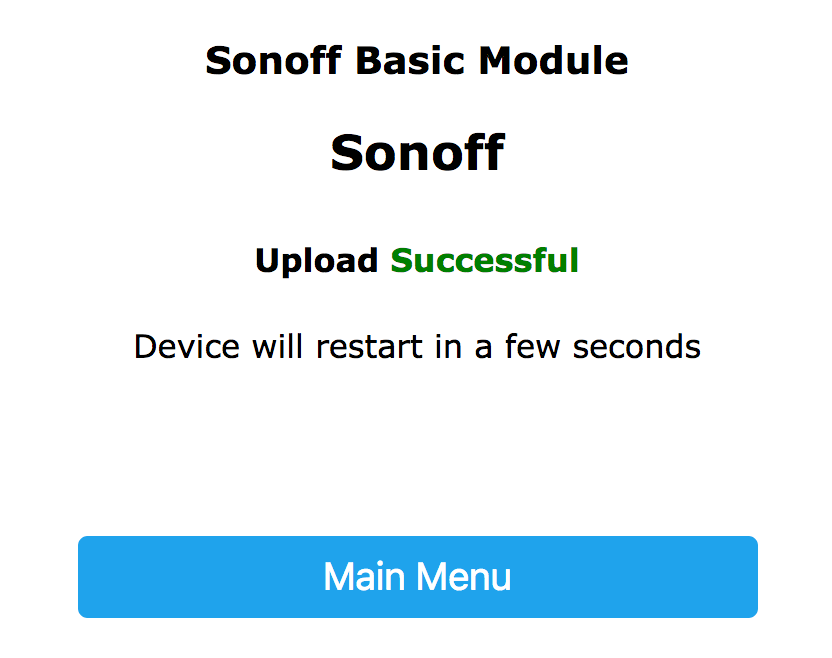
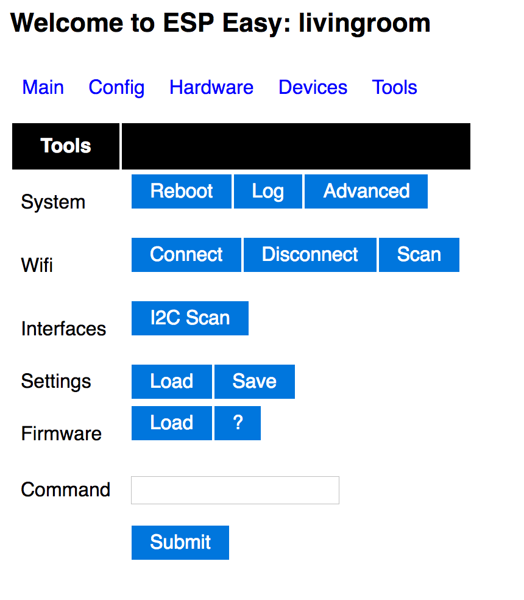

# Tasmota / ESPEasy migrieren

Die Migration von früheren Sonoff Tasmota- oder ESPEasy-Setups ist sehr einfach. Sie müssen lediglich eine Binärdatei von ESPHome erstellen lassen und diese dann im Webinterface hochladen.

## Download Binary
::: tip
Folgen Sie zunächst der Anleitung [Mein erstes Gerät](./myfirstdevice.md) und erstellen Sie eine Konfigurationsdatei. Anschließend generieren Sie die Binärdatei und laden sie herunter:
:::


## Binary hochladen
Um das Binary hochzuladen, navigieren Sie zur Tasmota/ESPEasy-Weboberfläche

### Tasmota

Gehen Sie in den Bereich "Firmware-Upgrade".



Wählen Sie im Abschnitt "Upgrade per Datei-Upload" die zuvor heruntergeladene Binärdatei



Wenn alles erfolgreich war, sehen Sie die Meldung "Upload Successful" und ESPHome
wird sich mit dem WiFi-Netzwerk verbinden, das in Ihrer .yaml-Datei konfiguriert ist. 🎉



::: warning
Wenn Sie die Plattform `esp8266_pwm output </components/output/esp8266_pwm>` verwenden und
von Tasmota wechseln, müssen Sie das Gerät einmal ausschalten. Danach
funktioniert die Dimmfunktionalität wie gewohnt und es sind keine weiteren Stromzyklen erforderlich.
:::

::: tip
Wenn Sie Tasmota 8+ verwenden und nach dem Hochladen der Firmware einen Fehler erhalten, gehen Sie in die Konsole und geben Sie ```SetOption78 1``` ein, dann starten Sie das Gerät neu und versuchen die Firmware erneut.
:::

### ESPEasy

Gehen Sie in den Bereich "Tools ".



Drücken Sie unter "Firmware" auf "Load", wählen Sie dann das zuvor heruntergeladene Binary aus und laden Sie
die Binärdatei. Wenn alles erfolgreich war, sollten Sie nun ESPHome auf Ihrem Knoten haben 🎉.

::: tip
Mit ESPHome müssen Sie sich in den meisten Fällen keine Gedanken über die verfügbare Flash-Größe machen, da
die Binärdatei immer nur den Code enthält, den Sie tatsächlich verwenden.
:::